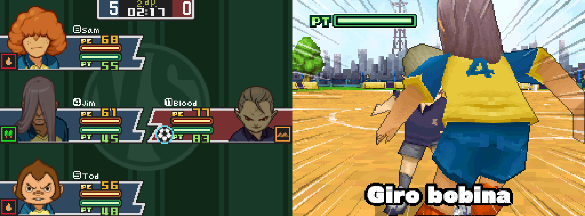
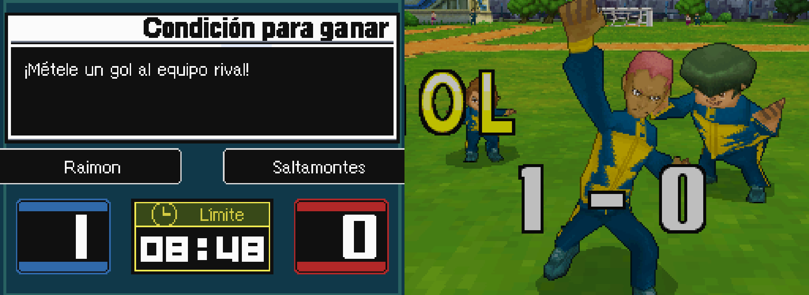
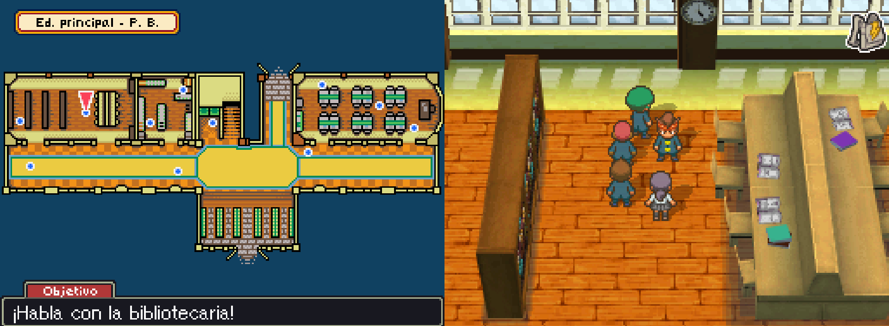
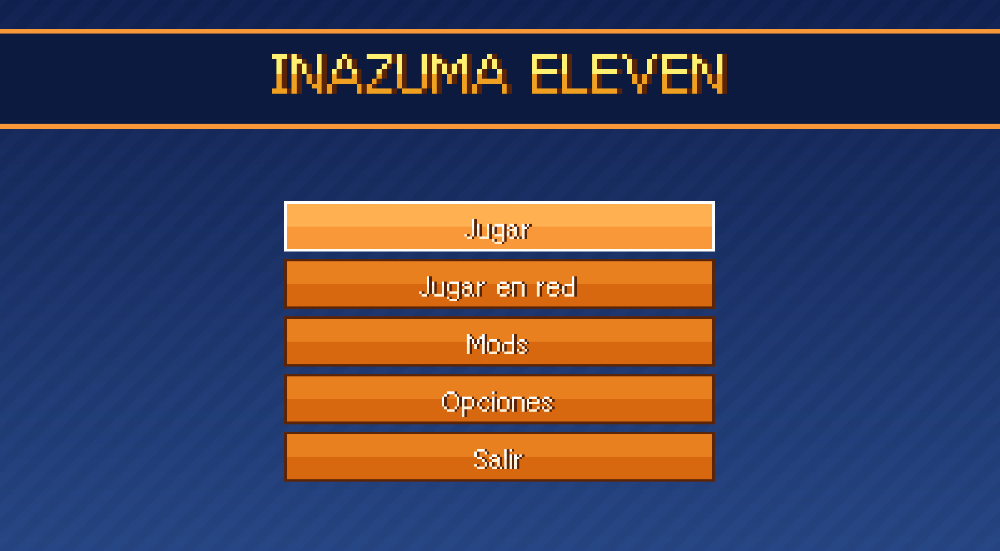
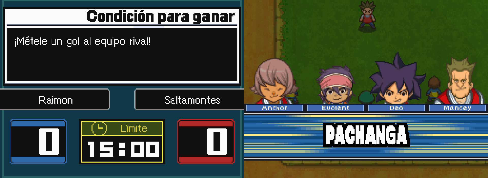

# Inazuma Eleven Recomp - Port para PC (InazumaElevenRecomp)

  
  
  
  

> **Alpha: puede haber errores.** Un port nativo para PC de **Inazuma Eleven**
> (Nintendo DS, versión europea) hecho por recompilación estática con
> [ndsrecomp](https://github.com/RetroPortingToolKit/ndsrecomp). Es un proyecto
> de fans, no un producto terminado.
>
> *In English: [README.md](README.md)*

El código del juego se tradujo de antemano a código nativo de PC, así que
funciona a velocidad completa sin emulador. **Necesitas tu propia ROM,
obtenida legalmente.** Este repositorio no contiene ninguna ROM, BIOS,
firmware, partida ni código generado a partir de la ROM.

## Descargar y jugar

1. Descarga el ZIP de Windows más reciente de **Releases** y descomprímelo.
2. Arrastra tu ROM sobre **`PREPARAR - arrastra aqui tus ROM.bat`** (puedes
   soltar varias a la vez). Reconoce cada ROM y prepara todo.
3. Abre **`Inazuma Eleven.exe`** y pulsa **Jugar**.

Las instrucciones completas para jugar vienen en la descarga, en cinco idiomas
(`LEEME.txt`, `README.txt`, `LISEZMOI.txt`, `LIESMICH.txt`, `LEGGIMI.txt`).

## Novedades de la v1.1.1

Solo correcciones de los mods:

- **Valor en las supertécnicas:** el panel sigue el propio guion del juego
  para la animación de cada técnica (los 9 intérpretes de guion de
  `0x020DBEF8`, marca de "en marcha" en `+0x248`) en vez de adivinar con los
  negros de pantalla. Ya no se queda en pantalla después de una parada, no
  desaparece cuando la pantalla parpadea un fotograma, enseña las paradas que
  el juego decide sin tirada (tiro normal contra técnica del portero,
  `ov87 0x02179A30`) y ya no pone "calculando" en tiros normales bloqueados ni
  en tiros que se van fuera. Comprobado con un banco de pruebas de 43 jugadas
  reales sacadas de registros de partidos.
- **Mecánicas IE2 (niveles de supertécnicas):** el juego suma el uso al elegir
  la técnica, antes de su cartel; ahora el cartel lleva el grado que tenía al
  usarla y el aviso "Nv +" sale después, como en el IE2.
- **Voces japonesas:** solo se cambian los bancos de voces de los jugadores;
  cinco bancos de efectos cuya versión japonesa tiene otro número de sonidos
  se quedan europeos, así que los bloqueos de tiro vuelven a sonar.

## Novedades de la v1.1

- **Rendimiento:** las supertécnicas más pesadas (Regate Múltiple, Ruptura
  Relámpago, Triángulo Z...) pasan de 46-50 FPS a **57-60 FPS** en un Ryzen 5
  2600 + GTX 1650. Ahora sí se usa el modelo de ejecución rápido
  ("rendimiento") y el envío de comandos 3D
  del juego se hace de forma nativa: su función de listas de comandos
  (`0x0202B608`) y el bucle de copia al GXFIFO (`0x020091C8`) funcionan como
  código de alto nivel que escribe directamente en el motor 3D, en lugar de
  pasar palabra a palabra por el manejador de E/S.
- Paquetes de idioma en **francés, alemán e italiano**, creados por el
  preparador con tus propias ROM (textos del juego, textos de los menús del
  código y sus voces si esa versión las tiene propias). El menú Esc y el lanzador también están traducidos.
- **Volumen** en Esc > Sistema (se recuerda entre sesiones).
- **Reiniciar** funciona siempre: el lanzador, que espera oculto, vuelve a
  abrir el juego con el idioma y los mods elegidos (la v1.0 abría cada proceso
  nuevo desde el anterior y se cerraba al tercer reinicio).
- La ventana se llama "Inazuma Eleven Recomp - FPS - v1.1.x"; el lanzador y el
  juego usan el icono de la DS sacado de tu ROM.
- Mods nuevos: **Mecánicas IE2** (niveles de supertécnicas, tiro del IE2,
  bloqueos de tiro, talentos, Mark se puede quitar del equipo tras la
  historia, experiencia doble), **Valor en las supertécnicas**, **Ojeo
  instantáneo**, **Filtros de supertécnicas** y **Colores por afinidad**.
- Entrenamiento libre: sube de nivel a un jugador pagando Pasión (Y) o
  devuélvelo gratis al nivel 1 (X).

## ROM necesaria

| campo | valor |
| --- | --- |
| título | `INAZUMA11` |
| código | `YEEP` (Europa, inglés, rev 0) |
| SHA-1 | `d55169c0b93d26b4037379d3b81a61b5404945e5` |

ROM opcionales (el preparador las detecta):

| ROM | código | añade |
| --- | --- | --- |
| Inazuma Eleven (Europa, español) | `YEES` | Textos y voces en español |
| Inazuma Eleven (Europa, francés) | `YEEF` | Textos en francés |
| Inazuma Eleven (Europa, alemán) | `YEED` | Textos en alemán |
| Inazuma Eleven (Europa, italiano) | `YEEI` | Textos en italiano |
| Inazuma Eleven (Japón) | `YEEJ` | Mod de voces japonesas |

## Qué funciona

- El juego completo con el runner de ndsrecomp, a 60 FPS (57-60 en las
  supertécnicas más pesadas).
- Lanzador: jugar, mods (con su ficha de información), opciones (idioma,
  voces, ventana, tamaño, disposición, escalado, VSync y controles) y **juego
  en red**.
- Menú Esc dentro del juego en español, inglés, francés, alemán o italiano
  (pantalla, idioma, teclas, estados, mods, volumen, reiniciar).
- **Juego inalámbrico entre dos PC** (misma red, o por internet con una red
  local virtual como Radmin VPN o ZeroTier).
- Paquetes de idioma creados con tus propias ROM (textos y textos del código
  en español, francés, alemán e italiano; voces en español; voces japonesas).

## Mods incluidos

- **Entrenamiento libre**: al terminar la historia, un entrenador en lo alto
  de la Torre te deja entrenar a tus jugadores, subirlos de nivel pagando
  Pasión o devolverlos al nivel 1.
- **Mecánicas IE2**: las supertécnicas suben de nivel con el uso (aviso
  "Nv +" y marcas), el botón de tiro y los tiros largos del IE2, bloqueos de
  tiro, talentos, Mark se puede quitar del equipo tras la historia y
  experiencia doble si ganas un encuentro por 5 o más goles sin encajar. Todo
  usa código que el juego ya tenía, sin activar.
- **Valor en las supertécnicas**: el valor total de los dos jugadores en las
  escenas de las supertécnicas, con el ganador en rojo.
- **Ojeo instantáneo**: las búsquedas de Celia y Nelly terminan al momento.
- **Filtros de supertécnicas**: filtra y ordena los cuadernos de
  supertécnicas.
- **Colores por afinidad**: los nombres de las técnicas con el color de su
  afinidad, como en Victory Road.
- **Voces japonesas** (necesita la ROM japonesa).

## Limitaciones conocidas

- Alpha: puede haber cierres, fallos gráficos o de sonido. Haz copias de tu
  partida (`datos\ie1_eur.sav`).
- El juego en red se ha probado con dos copias en el mismo PC y por la red de
  casa; por internet depende del ping (mejor con latencia baja).
- Como base solo se admite exactamente la ROM inglesa de arriba.

## Compilar desde el código

Mira [docs/BUILDING.md](docs/BUILDING.md). Necesitas tu propia ROM para generar
el código recompilado; el repositorio incluye los datos de cobertura (solo
direcciones) que se usan para generarlo.

## Créditos

- **Dosmildos** ([2002-source](https://github.com/2002-source)): creador de este port, sus mods, herramientas y lanzador.
- Desarrollado con la ayuda de **Claude** (Anthropic).
- [**ndsrecomp**](https://github.com/RetroPortingToolKit/ndsrecomp), de mstan y
  RetroPortingToolkit: el recompilador estático de Nintendo DS y el runner
  sobre los que está hecho este port.
- [**melonDS**](https://github.com/melonDS-emu/melonDS): el Wi-Fi, la red y el
  3D en los que se apoya el runner de ndsrecomp.
- **FreeBIOS** (incluida en ndsrecomp): la BIOS libre que usa el arranque por
  defecto.
- [**MetroidPrimeHuntersRecomp**](https://github.com/mstan/MetroidPrimeHuntersRecomp):
  referencia de cómo se organiza un proyecto de juego sobre ndsrecomp.

## Licencia

El código original de este repositorio (herramientas, complemento de mods,
lanzador, empaquetado) es MIT: ver [LICENSE](LICENSE). Los parches de
`runner-patches/` modifican archivos GPL-3.0-or-later del runner de ndsrecomp y
son GPL-3.0-or-later; el ejecutable del runner que se reparte es una obra
combinada GPL-3.0-or-later (ver `runner-patches/LICENSE.md`). ndsrecomp,
melonDS y FreeBIOS mantienen sus propias licencias.

Inazuma Eleven es una marca de LEVEL-5 Inc. Las imágenes de firmware/BIOS de
Nintendo DS, las ROM, las partidas y todos los datos derivados del juego
pertenecen a sus respectivos titulares y no se distribuyen.
