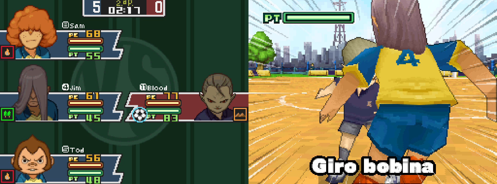
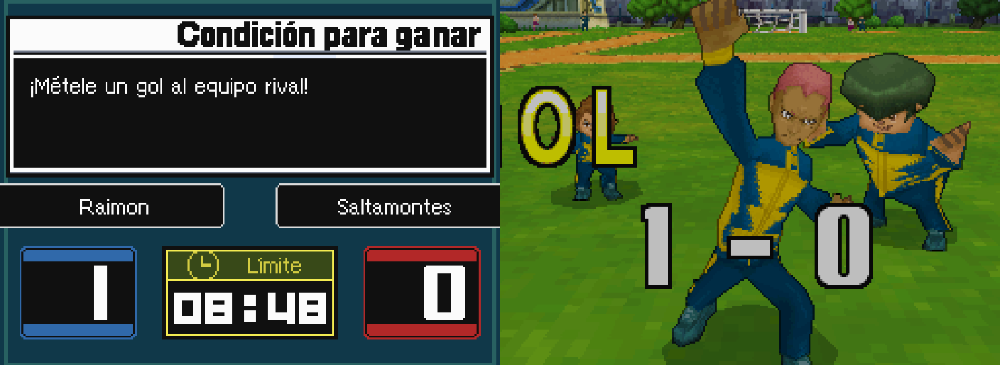
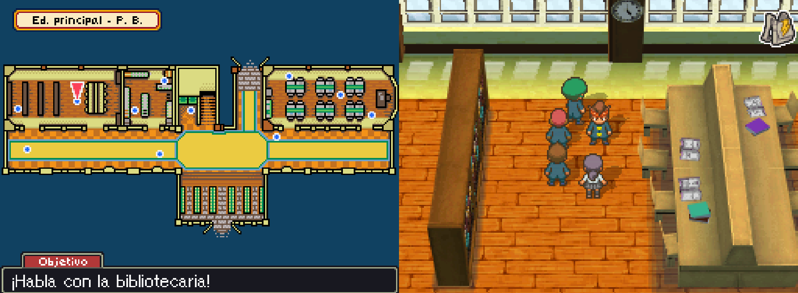
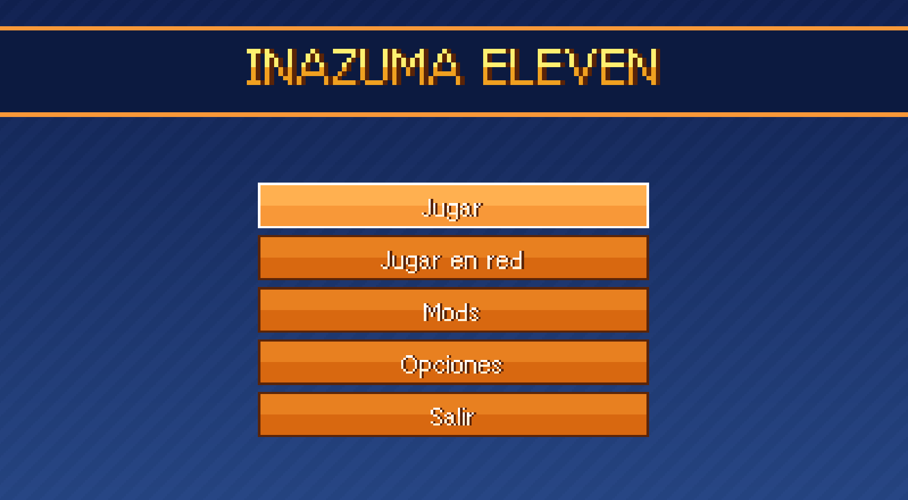
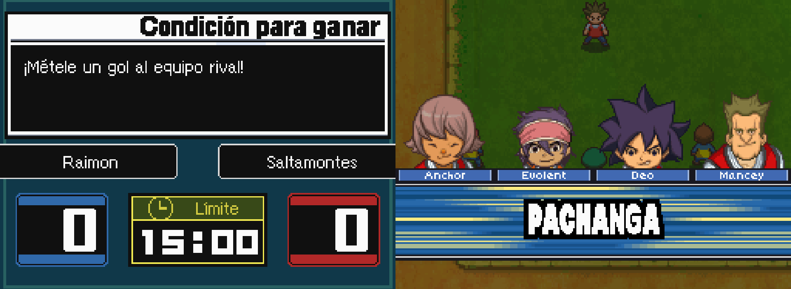

# Inazuma Eleven - Port para PC (InazumaElevenRecomp)

  
  
  
  

> **Alpha: puede haber errores.** Un port nativo para PC de **Inazuma Eleven**
> (Nintendo DS, versión europea) hecho por recompilación estática con
> [ndsrecomp](https://github.com/RetroPortingToolKit/ndsrecomp). Es un proyecto
> de fans, no un producto terminado.
>
> *In English: [README.md](README.md)*

El código del juego se tradujo de antemano a código nativo de PC, así que
funciona a velocidad completa sin emulador. **Necesitas tu propia ROM,
obtenida legalmente.** Este repositorio no contiene ninguna ROM, BIOS,
firmware, partida ni código generado a partir de la ROM.

## Descargar y jugar

1. Descarga el ZIP de Windows más reciente de **Releases** y descomprímelo.
2. Arrastra tu ROM sobre **`PREPARAR - arrastra aqui tus ROM.bat`** (puedes
   soltar varias a la vez). Reconoce cada ROM y prepara todo.
3. Abre **`Inazuma Eleven.exe`** y pulsa **Jugar**.

Las instrucciones completas para jugar vienen en la descarga (`LEEME.txt` /
`README.txt`).

## ROM necesaria

| campo | valor |
| --- | --- |
| título | `INAZUMA11` |
| código | `YEEP` (Europa, inglés, rev 0) |
| SHA-1 | `d55169c0b93d26b4037379d3b81a61b5404945e5` |

ROM opcionales (el preparador las detecta):

| ROM | código | añade |
| --- | --- | --- |
| Inazuma Eleven (Europa, español) | `YEES` | Textos y voces en español |
| Inazuma Eleven (Japón) | `YEEJ` | Mod de voces japonesas (cinemáticas) |

## Qué funciona

- El juego completo con el runner de ndsrecomp, a 60 FPS (modo rendimiento).
- Lanzador: jugar, mods (con su ficha de información), opciones (idioma,
  voces, ventana, tamaño, disposición, escalado, VSync y controles) y **juego
  en red**.
- Menú Esc dentro del juego en español o inglés (pantalla, idioma, teclas,
  estados, mods, reiniciar).
- **Juego inalámbrico entre dos PC** (misma red, o por internet con una red
  local virtual como Radmin VPN o ZeroTier).
- Paquetes de idioma creados con tus propias ROM (textos, voces y textos del
  código en español; voces japonesas).

## Mods incluidos

- **Entrenamiento libre + NPC entrenador**: al terminar la historia, un
  entrenador en la plataforma de la Torre te deja entrenar a tus jugadores.
- **Niveles de supertécnicas**: las supertécnicas suben de nivel con el uso,
  como en el Inazuma Eleven 2 (aviso "Nv +" y marcas junto al nombre).
- **Voces japonesas** (necesita la ROM japonesa).

## Limitaciones conocidas

- Alpha: puede haber cierres, fallos gráficos o de sonido. Haz copias de tu
  partida (`datos\ie1_eur.sav`).
- El juego en red se ha probado con dos copias en el mismo PC y por la red de
  casa; por internet depende del ping (mejor con latencia baja).
- Solo se admite exactamente la ROM de arriba.

## Compilar desde el código

Mira [docs/BUILDING.md](docs/BUILDING.md). Necesitas tu propia ROM para generar
el código recompilado; el repositorio incluye los datos de cobertura (solo
direcciones) que se usan para generarlo.

## Créditos

- **Dosmildos** ([2002-source](https://github.com/2002-source)): creador de este port, sus mods, herramientas y lanzador.
- Desarrollado con la ayuda de **Claude** (Anthropic).
- [**ndsrecomp**](https://github.com/RetroPortingToolKit/ndsrecomp), de mstan y
  RetroPortingToolkit: el recompilador estático de Nintendo DS y el runner
  sobre los que está hecho este port.
- [**melonDS**](https://github.com/melonDS-emu/melonDS): el Wi-Fi, la red y el
  3D en los que se apoya el runner de ndsrecomp.
- **FreeBIOS** (incluida en ndsrecomp): la BIOS libre que usa el arranque por
  defecto.
- [**MetroidPrimeHuntersRecomp**](https://github.com/mstan/MetroidPrimeHuntersRecomp):
  referencia de cómo se organiza un proyecto de juego sobre ndsrecomp.

## Licencia

El código original de este repositorio (herramientas, complemento de mods,
lanzador, empaquetado) es MIT: ver [LICENSE](LICENSE). Los parches de
`runner-patches/` modifican archivos GPL-3.0-or-later del runner de ndsrecomp y
son GPL-3.0-or-later; el ejecutable del runner que se reparte es una obra
combinada GPL-3.0-or-later (ver `runner-patches/LICENSE.md`). ndsrecomp,
melonDS y FreeBIOS mantienen sus propias licencias.

Inazuma Eleven es una marca de LEVEL-5 Inc. Las imágenes de firmware/BIOS de
Nintendo DS, las ROM, las partidas y todos los datos derivados del juego
pertenecen a sus respectivos titulares y no se distribuyen.
