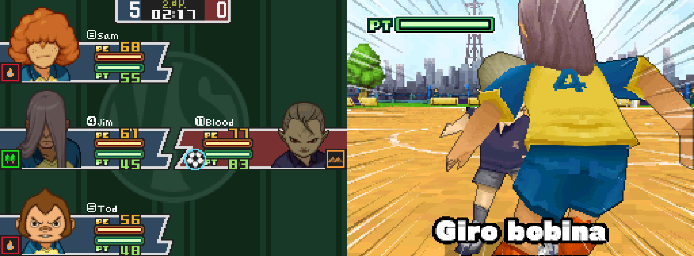
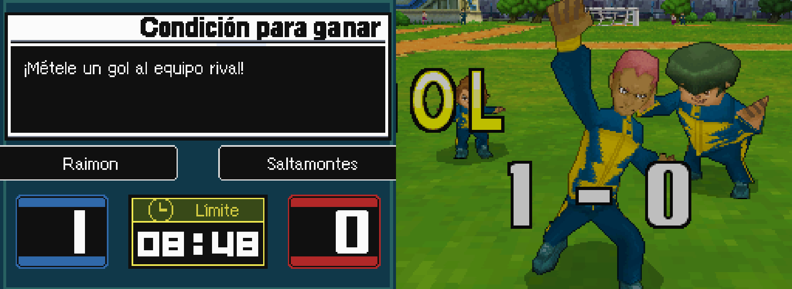
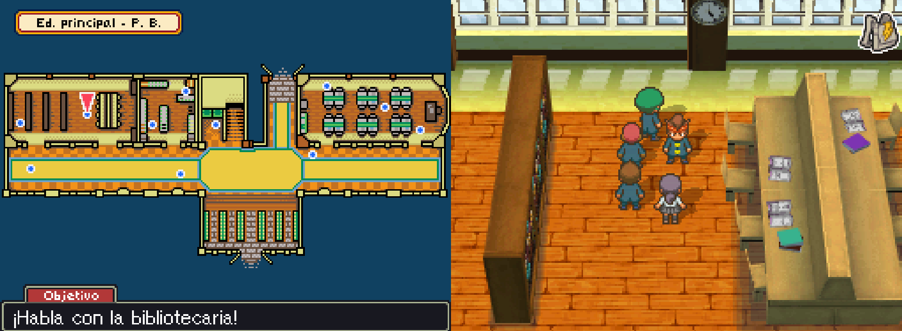
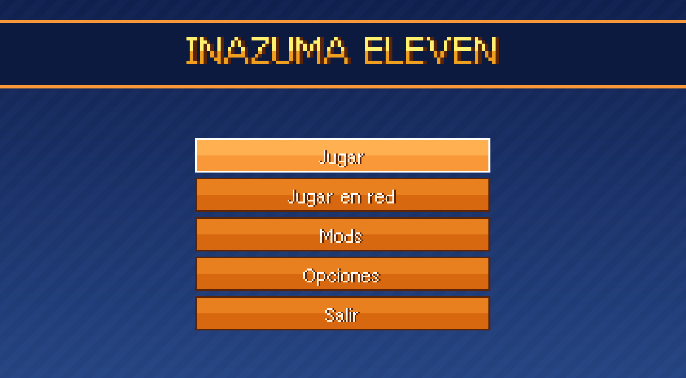
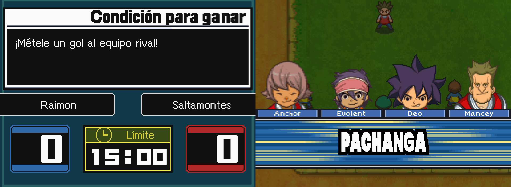

# Inazuma Eleven Recomp - PC Port (InazumaElevenRecomp)

  
  
  
  

> **Alpha - bugs are expected.** A native PC port of **Inazuma Eleven**
> (Nintendo DS, European release) made by static recompilation with
> [ndsrecomp](https://github.com/RetroPortingToolKit/ndsrecomp). It is a fan
> project, not a finished product.
>
> *En español: [README.es.md](README.es.md)*

The game's code was translated to native PC code ahead of time, so it runs at
full speed without an emulator. **You provide your own legally obtained ROM.**
No Nintendo ROM, BIOS, firmware, save data, or generated ROM-derived source is
distributed in this repository.

## Download and play

1. Download the latest Windows ZIP from **Releases** and extract it.
2. Drag your ROM onto **`PREPARAR - arrastra aqui tus ROM.bat`** (you can drop
   several ROMs at once). It recognises each ROM and prepares everything.
3. Run **`Inazuma Eleven.exe`** and press **Play**.

Full player instructions are in the release, in five languages (`README.txt`,
`LEEME.txt`, `LISEZMOI.txt`, `LIESMICH.txt`, `LEGGIMI.txt`).

## What's new in v1.1

- **Performance:** the heaviest special moves (Multi-dribble, Lightning
  Burst, Triangle Z...) went from 46-50 FPS to **57-60 FPS** on a Ryzen 5 2600
  + GTX 1650. The fast "performance" execution model is now really used,
  and the game's 3D command path is
  handled natively: its command-list function (`0x0202B608`) and the GXFIFO
  copy loop (`0x020091C8`) run as high-level code that writes straight to the
  3D engine, instead of going through the I/O handler word by word.
- **French, German and Italian** language packs, built from your own ROMs by
  the preparer (game text, in-code menu text, and voices where that version has its own). The Esc menu and
  the launcher are also translated.
- **Volume** in Esc > System (remembered between sessions).
- **Restart** works every time: the launcher, waiting hidden, reopens the
  game with the chosen language and mods (v1.0 started each new process from
  the previous one and closed after the third restart).
- The window title is "Inazuma Eleven Recomp - FPS - v1.1"; the launcher and
  the game use the DS icon from your ROM.
- New mods: **IE2 mechanics** (move levels, IE2 shooting, shot blocks,
  talents, Mark can leave the team after the story, double EXP), **total
  power in special move scenes**, **instant scouting**, **special move
  filters** and **affinity colours**.
- Free training: level up a player paying Passion (Y) or send them back to
  level 1 for free (X).

## Required ROM

| field | value |
| --- | --- |
| title | `INAZUMA11` |
| game code | `YEEP` (Europe, English, rev 0) |
| SHA-1 | `d55169c0b93d26b4037379d3b81a61b5404945e5` |

Optional ROMs (the preparer detects them):

| ROM | code | adds |
| --- | --- | --- |
| Inazuma Eleven (Europe, Spanish) | `YEES` | Spanish text and voices |
| Inazuma Eleven (Europe, French) | `YEEF` | French text |
| Inazuma Eleven (Europe, German) | `YEED` | German text |
| Inazuma Eleven (Europe, Italian) | `YEEI` | Italian text |
| Inazuma Eleven (Japan) | `YEEJ` | Japanese voices mod |

## What works

- Full game through the ndsrecomp runner, at 60 FPS (57-60 in the heaviest
  special moves).
- Launcher: play, mods (with info sheets), options (language, voices, window,
  size, layout, scaling, VSync, controls) and **network play**.
- In-game Esc menu in English, Spanish, French, German or Italian (display,
  language, keys, save states, mods, volume, restart).
- **Local wireless play between two PCs** (same network, or over the
  internet with a virtual LAN such as Radmin VPN or ZeroTier).
- Language packs built from your own ROMs (Spanish, French, German and
  Italian text and in-code text; Spanish voices; Japanese voices).

## Mods included

- **Free training**: after finishing the story, a trainer on top of the Tower
  lets you train your players, level them up paying Passion or send them back
  to level 1.
- **IE2 mechanics**: special moves level up with use ("Lv +" notice and level
  marks), the IE2 shoot button and long shots, shot blocks, talents, Mark can
  leave the team after the story, and double EXP when you win a random
  encounter by 5+ goals without conceding. All of it uses code the game
  already had, switched off.
- **Total power in special moves**: both players' total power during special
  move scenes, with the winner in red.
- **Instant scouting**: Celia's and Nelly's player searches finish at once.
- **Special move filters**: filter and sort the special move manuals.
- **Affinity colours**: move names in the colour of their element, like in
  Victory Road.
- **Japanese voices** (needs the Japanese ROM).

## Known limits

- Alpha: crashes, glitches or audio issues may happen. Keep backups of your
  save (`datos\ie1_eur.sav`).
- Network play has been tested between two copies on the same PC and over a
  home network path; play over the internet depends on ping (low latency
  recommended).
- Only the exact English ROM above is supported as the base.

## Building from source

See [docs/BUILDING.md](docs/BUILDING.md). You need your own ROM to generate the
recompiled code; the repository ships the coverage data (addresses only) used
to generate it.

## Credits

- **Dosmildos** ([2002-source](https://github.com/2002-source)) - creator of this port, its mods, tools and launcher.
- Developed with the help of **Claude** (Anthropic).
- [**ndsrecomp**](https://github.com/RetroPortingToolKit/ndsrecomp) by mstan and
  RetroPortingToolkit - the Nintendo DS static recompiler and runner this port
  is built on.
- [**melonDS**](https://github.com/melonDS-emu/melonDS) - Wi-Fi controller,
  network and 3D foundations used by the ndsrecomp runner.
- **FreeBIOS** (shipped with ndsrecomp) - the free DS BIOS replacement used by
  the default startup path.
- [**MetroidPrimeHuntersRecomp**](https://github.com/mstan/MetroidPrimeHuntersRecomp)
  - reference for how a title project on ndsrecomp is organised.

## License

The original code in this repository (tools, mods plugin, launcher, packaging)
is MIT licensed - see [LICENSE](LICENSE). The patches in `runner-patches/`
modify GPL-3.0-or-later files of the ndsrecomp runner and are GPL-3.0-or-later;
the distributed runner binary is a GPL-3.0-or-later combined work (see
`runner-patches/LICENSE.md`). ndsrecomp, melonDS and FreeBIOS keep their own
licenses.

Inazuma Eleven is a trademark of LEVEL-5 Inc. Nintendo DS firmware/BIOS images,
ROMs, saves and all derived game data remain the property of their respective
copyright holders and are not distributed.
