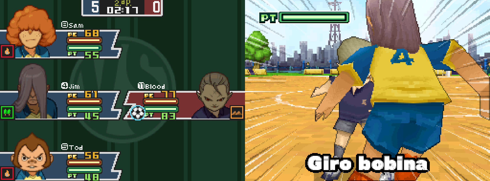
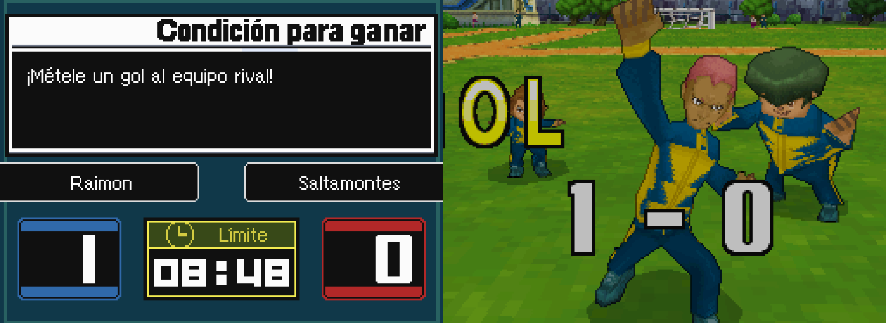
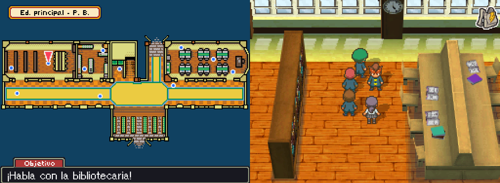
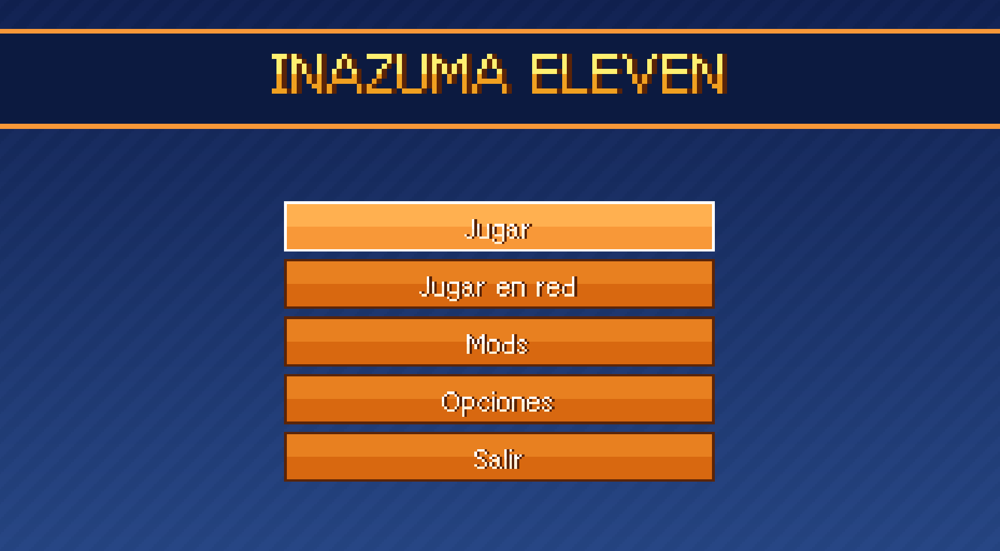
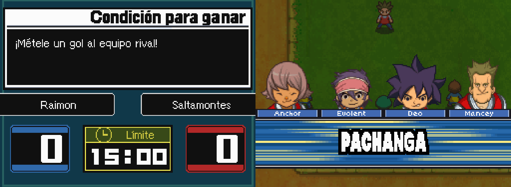

# Inazuma Eleven PC Port (InazumaElevenRecomp)

  
  
  
  

> **Alpha - bugs are expected.** A native PC port of **Inazuma Eleven**
> (Nintendo DS, European release) made by static recompilation with
> [ndsrecomp](https://github.com/RetroPortingToolKit/ndsrecomp). It is a fan
> project, not a finished product.
>
> *En español: [README.es.md](README.es.md)*

The game's code was translated to native PC code ahead of time, so it runs at
full speed without an emulator. **You provide your own legally obtained ROM.**
No Nintendo ROM, BIOS, firmware, save data, or generated ROM-derived source is
distributed in this repository.

## Download and play

1. Download the latest Windows ZIP from **Releases** and extract it.
2. Drag your ROM onto **`PREPARAR - arrastra aqui tus ROM.bat`** (you can drop
   several ROMs at once). It recognises each ROM and prepares everything.
3. Run **`Inazuma Eleven.exe`** and press **Play**.

Full player instructions are in the release (`README.txt` / `LEEME.txt`).

## Required ROM

| field | value |
| --- | --- |
| title | `INAZUMA11` |
| game code | `YEEP` (Europe, English, rev 0) |
| SHA-1 | `d55169c0b93d26b4037379d3b81a61b5404945e5` |

Optional ROMs (the preparer detects them):

| ROM | code | adds |
| --- | --- | --- |
| Inazuma Eleven (Europe, Spanish) | `YEES` | Spanish text and voices |
| Inazuma Eleven (Japan) | `YEEJ` | Japanese voices mod (cutscenes) |

## What works

- Full game through the ndsrecomp runner, at 60 FPS (performance mode).
- Launcher: play, mods (with info sheets), options (language, voices, window,
  size, layout, scaling, VSync, controls) and **network play**.
- In-game Esc menu in English or Spanish (display, language, keys, save
  states, mods, restart).
- **Local wireless play between two PCs** (same network, or over the
  internet with a virtual LAN such as Radmin VPN or ZeroTier).
- Language packs built from your own ROMs (Spanish text, voices and in-code
  text; Japanese voices).

## Mods included

- **Free training + Trainer NPC**: after finishing the story, a trainer on the
  Tower platform lets you train your players.
- **Move levels**: special moves level up with use, like in Inazuma Eleven 2
  ("Lv +" notice and level marks next to the move name).
- **Japanese voices** (needs the Japanese ROM).

## Known limits

- Alpha: crashes, glitches or audio issues may happen. Keep backups of your
  save (`datos\ie1_eur.sav`).
- Network play has been tested between two copies on the same PC and over a
  home network path; play over the internet depends on ping (low latency
  recommended).
- Only the exact ROM above is supported.

## Building from source

See [docs/BUILDING.md](docs/BUILDING.md). You need your own ROM to generate the
recompiled code; the repository ships the coverage data (addresses only) used
to generate it.

## Credits

- **Dosmildos** ([2002-source](https://github.com/2002-source)) - creator of this port, its mods, tools and launcher.
- Developed with the help of **Claude** (Anthropic).
- [**ndsrecomp**](https://github.com/RetroPortingToolKit/ndsrecomp) by mstan and
  RetroPortingToolkit - the Nintendo DS static recompiler and runner this port
  is built on.
- [**melonDS**](https://github.com/melonDS-emu/melonDS) - Wi-Fi controller,
  network and 3D foundations used by the ndsrecomp runner.
- **FreeBIOS** (shipped with ndsrecomp) - the free DS BIOS replacement used by
  the default startup path.
- [**MetroidPrimeHuntersRecomp**](https://github.com/mstan/MetroidPrimeHuntersRecomp)
  - reference for how a title project on ndsrecomp is organised.

## License

The original code in this repository (tools, mods plugin, launcher, packaging)
is MIT licensed - see [LICENSE](LICENSE). The patches in `runner-patches/`
modify GPL-3.0-or-later files of the ndsrecomp runner and are GPL-3.0-or-later;
the distributed runner binary is a GPL-3.0-or-later combined work (see
`runner-patches/LICENSE.md`). ndsrecomp, melonDS and FreeBIOS keep their own
licenses.

Inazuma Eleven is a trademark of LEVEL-5 Inc. Nintendo DS firmware/BIOS images,
ROMs, saves and all derived game data remain the property of their respective
copyright holders and are not distributed.
